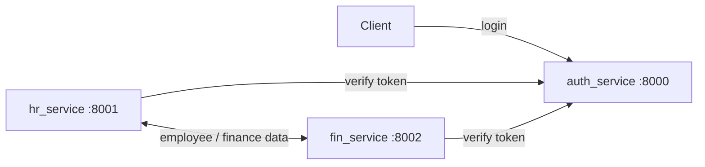

# Auth Service

A Django-based authentication microservice providing secure login, logout, and password management features. It integrates with external services and includes automatically generated API documentation.

---

## 📑 Table of Contents
- [Introduction](#introduction)  
- [Architecture](#architecture)  
- [Features](#features)  
- [Project Structure](#project-structure)  
- [Installation](#installation)  
- [Configuration](#configuration)  
- [Usage](#usage)  
- [API Documentation](#api-documentation)  
- [Dependencies](#dependencies)  
- [Troubleshooting](#troubleshooting)  
- [Contributors](#contributors)  
- [License](#license)  

---

## 🚀 Introduction
This project is an **authentication service** built with Django and Django REST Framework. It supports:
- Token-based authentication
- User management (login, logout, password change)
- Auto-generated OpenAPI schema and Swagger UI using **drf-spectacular**

The service is structured to be modular and can be integrated with external microservices such as HR and Finance.

---

## Architecture



The three services run separately; the ports above are the defaults from the example `local_settings.py`. The example configuration uses SQLite for local development. For a gateway-level example (per-field permissions, GraphQL, Redis Streams fan-out), see [graphql-gateway-demo](https://github.com/TaeseobK/graphql-gateway-demo).

## ✨ Features
- **Django Authentication** with token-based login/logout.  
- **REST API** endpoints for authentication workflows.  
- **API Documentation** powered by `drf-spectacular`.  
- **SQLite database** (default, configurable).  
- **Service integration** with HR (`http://localhost:8001`) and Finance (`http://localhost:8002`).  
- **Customizable settings** for local development via `local_settings.py`.  

---

## 📂 Project Structure
```
auth_service/
│── auth/                 # Django project root
│   ├── settings.py       # Main Django settings
│   ├── local_settings.py # Environment-specific overrides
│   ├── urls.py           # URL routes
│   ├── wsgi.py           # WSGI entry point
│── databases/            # SQLite database location
│── keys/                 # Warning and key files
```

---

## ⚙️ Installation

1. **Clone the repository**
   ```bash
   git clone https://github.com/TaeseobK/auth_service.git
   cd auth_service
   ```

2. **Create and activate a virtual environment**
   ```bash
   python -m venv venv
   source venv/bin/activate   # Linux/Mac
   venv\Scripts\activate      # Windows
   ```

3. **Install dependencies**
   ```bash
   pip install -r requirements.txt
   ```

4. **Create file migrations**
   ```bash
   python manage.py makemigrations
   ```

5. **Run database migrations**
   ```bash
   python manage.py migrate
   ```

6. **Start the development server**
   ```bash
   python manage.py runserver
   ```

---

## 🔧 Configuration
- All core settings are in `settings.py`.  
- Environment-specific overrides (e.g., databases, debug mode, service URLs) go in `local_settings.py`.

Example `local_settings.py`:
```python
HR_SERVICE = 'http://localhost:8001'
FIN_SERVICE = 'http://localhost:8002'

DEBUG_ = True

DATABASE_SERVICE = {
    'default': {
        'ENGINE': 'django.db.backends.sqlite3',
        'NAME': BASE_DIR / 'databases/db.sqlite3',
    }
}
```

---

## ▶️ Usage
- Access the service at:  
  ```
  http://127.0.0.1:8000/
  ```

- Example authentication flow:
  - `POST /api/token/login/` → Obtain token
  - `POST /api/token/logout/` → Invalidate token
  - `POST /api/change-password/` → Update password  

---

## 📖 API Documentation
- Swagger/OpenAPI documentation is available at:
  ```
  http://127.0.0.1:8000/api/schema/swagger-ui/
  ```
- JSON schema:
  ```
  http://127.0.0.1:8000/api/schema/
  ```

---

## 📦 Dependencies
Key dependencies include:
- **Django 5.2.5**  
- **Django REST Framework**  
- **drf-spectacular** & **drf-spectacular-sidecar**  
- **django-filters**  

(See `requirements.txt` for the full list.)

---

## 🛠 Troubleshooting
- Ensure `DEBUG_` is set correctly in `local_settings.py` for development.  
- Database file should exist under `databases/db.sqlite3`. Run `migrate` if missing.  
- If API docs do not load, check `drf-spectacular` installation and schema settings.  

---

## 👥 Contributors
- Afrizal Bayu Satrio (Initial Project and Mainteners)  

---

## 📜 License
This project is licensed under the [Unlicense](LICENSE).  
